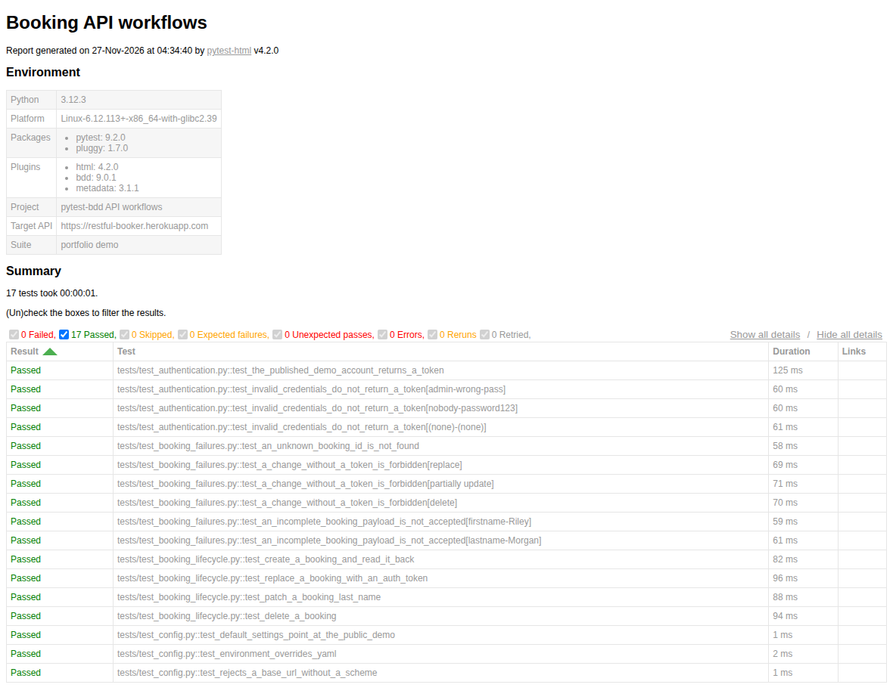

# pytest-bdd API workflows

Portfolio demo of an API workflow suite. Scenarios run against the public [Restful Booker](https://restful-booker.herokuapp.com) API. This is sample project code for hiring conversations, not employer code.

[](https://github.com/Potucky/PythonProject1/actions/workflows/ci.yml)

**Live test report:** https://potucky.github.io/pytest-bdd-api-workflows/

## What this project demonstrates

- **Multi-step API workflows.** A booking is created, read back, replaced, patched, and deleted, then the same id is read again to confirm it is gone.
- **Executable Gherkin on pytest.** Feature files use Scenario Outlines, example tables, and tags. pytest-bdd collects them, so the same suite answers `pytest`, `pytest -m smoke`, and `pytest -m regression`.
- **Negative cases next to the happy path.** Bad demo credentials, an unknown id, a body missing required fields, and update or delete calls that omit the token this API requires.
- **A small framework, not calls copied into every step.** Steps go through one client. URL, timeout, and the published demo account live in `config/settings.yaml` and can be overridden with environment variables.
- **CI that keeps the evidence.** GitHub Actions runs the suite on pull requests and on pushes to `main`, uploads the HTML and JUnit reports, and publishes the HTML report on GitHub Pages.

## Tech stack

- Python 3.12
- pytest and pytest-bdd
- requests
- pytest-html and JUnit XML
- GitHub Actions and GitHub Pages
- Public target API: Restful Booker

## Project structure

```text
config/settings.yaml                 # base URL, timeout, published demo account
src/booker/client.py                 # HTTP wrapper the steps call
src/booker/config.py                 # YAML plus BOOKER_* environment overrides
src/booker/payloads.py               # booking bodies
features/                            # Gherkin: lifecycle, auth, failures
steps/booking_steps.py               # step definitions
tests/                               # pytest-bdd bindings and config tests
pages/index.html                     # GitHub Pages landing page
.github/workflows/ci.yml             # test run and report artifact
.github/workflows/pages.yml          # test run and Pages deploy from main
```

## How to run locally

The API scenarios call the public Restful Booker API, so those tests need a network connection. No accounts or local services to start. The config tests only read YAML.

```bash
python3 -m venv .venv
source .venv/bin/activate
pip install -r requirements.txt
pytest
pytest -m smoke
pytest -m regression
pytest --html=reports/report.html --self-contained-html --junitxml=reports/junit.xml
```

`reports/report.html` is the same style of report CI uploads. Open it in a browser.

Optional environment overrides:

| Variable | Purpose |
| --- | --- |
| `BOOKER_BASE_URL` | API origin. Default is the public Restful Booker host. |
| `BOOKER_TIMEOUT` | Per-request timeout in seconds. |
| `BOOKER_USERNAME` | Demo account used when a scenario says it authenticates. |
| `BOOKER_PASSWORD` | Password for that account. |
| `BOOKER_CONFIG` | Path to a different YAML file. |

The checked-in account is `admin` / `password123`, the pair Restful Booker publishes for its demo. It is not a secret. Do not point the suite at a private host with real credentials.

GitHub Pages publishes from `.github/workflows/pages.yml` on each push to `main`. In the repository settings, **Pages → Build and deployment → Source** has to be **GitHub Actions** before that job can deploy.

## Test report

This is the pytest-html report from a local run of the suite.



## Test approach

- Each scenario creates the booking it needs. Nothing depends on an id that happened to already exist.
- After the scenario, the client deletes bookings it created, using the published demo token. A scenario that already deleted its booking tolerates the second delete.
- There are no sleeps in the tests. The client retries only a dropped connection or HTTP 502, 503, or 504, which this public Heroku app sometimes returns while it is waking up.
- Assertions check the status code and the fields that scenario cares about. A successful delete is asserted as 201 because that is what this API returns. An incomplete body is asserted as 500 for the same reason: that is the demo service's current response, and a change would fail the test on purpose.
- `@smoke` is the short path (create/read, replace, published login, and a change with no token). `@regression` is the wider set (patch, delete, bad credentials, unknown id, incomplete body). `pytest` with no marker runs both, plus the config tests. `@lifecycle`, `@auth`, and `@negative` group the three features.
- The invalid-login examples use `(none)` for an empty username or password. The step turns that into an empty string.

## Related portfolio repos

UI coverage is in a separate repo, [behave-bdd-ecommerce-tests](https://github.com/Potucky/behave-bdd-ecommerce-tests). Request checks without Gherkin are in [rest-api-testing-pytest](https://github.com/Potucky/rest-api-testing-pytest).

## Author

Vasyl Popovich, QA Automation Engineer, Miami, FL. GitHub: https://github.com/Potucky
